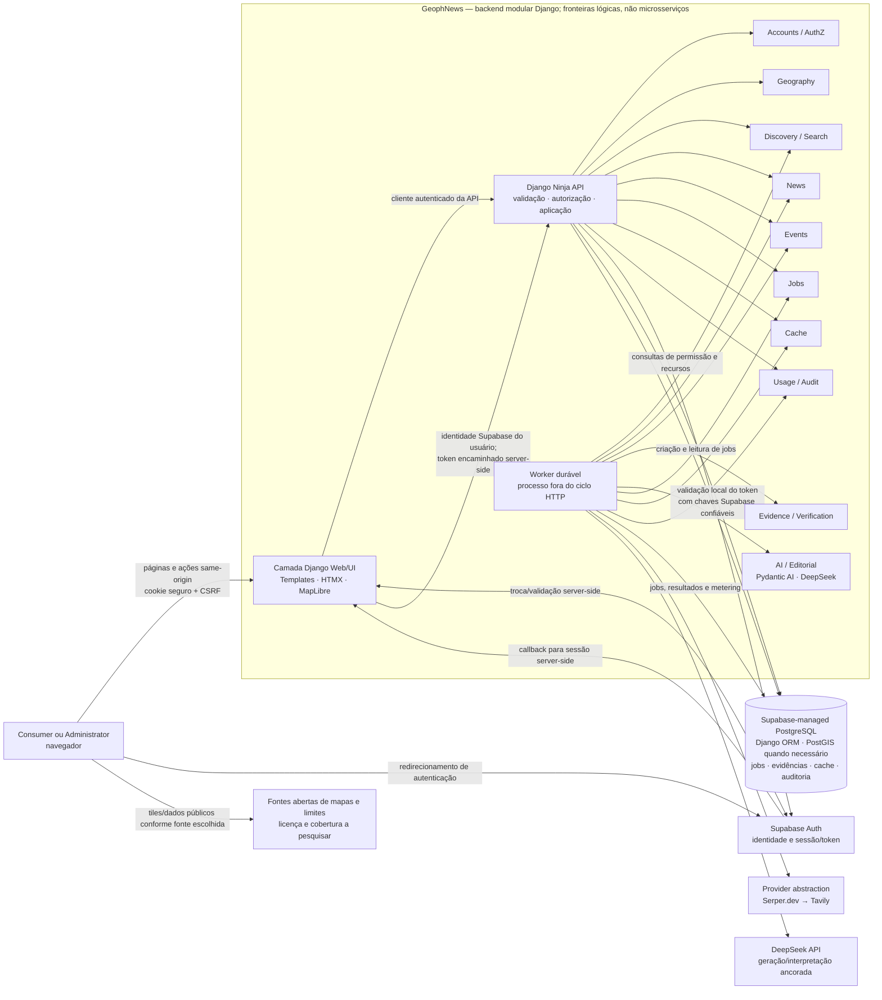
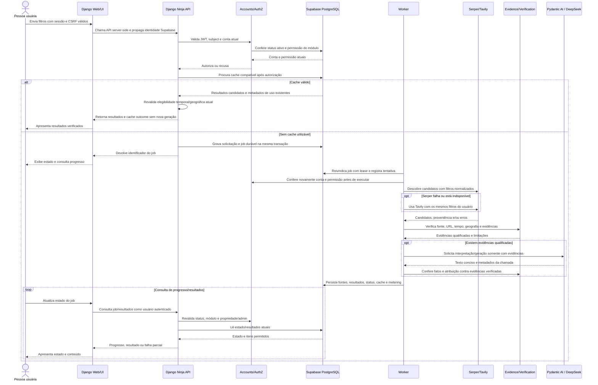

# Arquitetura — GeophNews

> **STATUS: APPROVED — decisões de arquitetura selecionadas pelo proprietário em 2026-11-12.** Este documento registra decisões de CONSTRUCTION em nível arquitetural. Não autoriza implementação, execução de especificação, alterações de produto ou atividades de OPERATIONS.

## 1. Propósito e autoridade

Esta arquitetura traduz as escolhas explícitas do proprietário em fronteiras lógicas, responsabilidades e fluxos de alto nível. Os seis artefatos aprovados de INCEPTION continuam sendo a fonte autoritativa para problema, objetivo, usuários, requisitos e escopo. Este documento não altera nem reinterpreta requisitos, inclusive RP-01; decisões técnicas ainda abertas estão identificadas como **UNDECIDED**.

Referências autoritativas preservadas:

- [Problem Definition](../inception/problem-definition.md)
- [Product Objective](../inception/product-objective.md)
- [Users and Roles](../inception/users-and-roles.md)
- [Approved Requirements](../inception/requirements.md)
- [Approved MVP Scope](../inception/mvp-scope.md)
- [INCEPTION decision register](../inception/open-decisions.md)
- [RP-01 in Project Context](../../context.md)

O registro não cria contratos formais, esquemas de API, modelos executáveis, migrações, código, testes, infraestrutura ou especificações de fase. Os nomes de recursos, entidades e estados abaixo são conceituais.

## 2. Decisões de arquitetura aprovadas

| # | Decisão selecionada pelo proprietário | Fronteira registrada |
|---|---|---|
| 1 | Backend como **modular monolith**, com separação explícita **API-first**. Django Ninja é construído primeiro; depois, uma camada Django Web/UI distinta consome a API. | API é dona da lógica de negócio, autorização e validação. UI é cliente da API. Os limites são lógicos; não exigem microsserviços, repositórios ou deploys separados. A topologia de processos/deploy permanece UNDECIDED. |
| 2 | **Supabase Auth** para cadastro/login por e-mail/senha e Google, identidade e emissão de sessão/token. | Django valida credenciais Supabase e aplica status ativo, permissões independentes NEWS/EVENT AGENDA e autorização administrativa. Nova conta Consumer inicia inativa e sem permissões de módulo. Primeiro Administrator é provisionado por processo manual seguro; não há autoinscrição pública de administrador. |
| 3 | **Supabase-managed PostgreSQL** como persistência compartilhada, acessada pelo Django ORM para tabelas apropriadas e com PostGIS quando necessário. | Supabase Auth é dono dos registros de identidade e credenciais. A aplicação guarda o vínculo com o sujeito Auth, papel, estado e permissões, além dos registros operacionais descritos abaixo; não duplica senhas nem responsabilidades de autenticação. |
| 4 | **MapLibre GL JS** com conjuntos de dados geográficos abertos, verificáveis e compatíveis com OSM. | Suportar seleção WORLD, continente, país, estado/região, cidade ou bairro e encerrar em qualquer nível. Licenciamento, geocodificação e limites administrativos específicos ficam para pesquisa técnica; limites não verificados não são inventados. |
| 5 | Abstração comum de provedores de descoberta. | Serper.dev é tentado primeiro; Tavily é fallback em erro ou indisponibilidade. Resultados, proveniência e falhas são normalizados sem ampliar silenciosamente filtros. |
| 6 | Pipeline híbrido, determinístico e apoiado por LLM. | Python aplica autenticação/autorização, elegibilidade temporal/geográfica, verificação de fonte/URL, deduplicação e outras regras mecânicas auditáveis. Pydantic AI com DeepSeek apoia interpretação semântica, relevância e geração concisa ancorada em evidências. Saídas passam por validações; URLs e fatos não são inventados. LangGraph e RAG não fazem parte do MVP. |
| 7 | Buscas executam como **background jobs assíncronos**. | API devolve identificador de job; worker independente do ciclo HTTP executa descoberta, validação e geração e persiste estado/progresso. A UI consulta o estado e apresenta resultados. O desenho durável usa PostgreSQL; Celery e Redis não são requisitos assumidos. |
| 8 | Cache de busca/resultados no PostgreSQL por **10 minutos**. | Separar idioma e dimensões dos filtros, revalidar elegibilidade de notícias/eventos ao apresentar, reautorizar a cada solicitação e distinguir chamadas reais ao DeepSeek de cache hits. |
| 9 | UI com **Django Templates, HTMX e MapLibre GL JS**, construída depois da API. | UI consome a API de forma autenticada e protegida contra CSRF; chaves secretas não são expostas ao navegador. React e Next.js não são adotados. |
| 10 | Logs estruturados, auditoria e metering persistidos no Supabase PostgreSQL. | Correlacionar requisição/job, usuário, módulo, provedor/modelo, fontes verificadas, status, tempos e cache; registrar tokens DeepSeek de entrada/saída/total e custo estimado quando houver preço verificável. Uso/custo de busca permanece separado. Administração limita-se a status e permissões por conta e relatórios individuais de uso/custo. |
| 11 | Estratégia de qualidade em camadas com pytest/Django, doubles para serviços externos e validações de API, autenticação/autorização, NEWS/EVENT independentes, jobs, cache, integração e ponta a ponta por usuário. | Meta inicial de validação: p95 ≤ 120 s, até 10 resultados e até cinco usuários concorrentes, em condições normais controladas, medida separadamente por NEWS e EVENT AGENDA. É alvo de validação, não SLA. |

### Semântica aprovada que os componentes devem preservar

- Existem exatamente dois tipos de conta do produto: Consumer/User e Administrator. A pessoa precisa autenticar-se; Consumer novo começa inativo e sem NEWS/EVENT AGENDA. Apenas Administrator pode ativar/desativar e conceder/revogar cada permissão de forma independente. Relatórios individuais de uso/custo são permitidos; moderação, configuração de provider, quotas administrativas e operações gerais não pertencem à UI de administração.
- Consultas são sob demanda, sem crawling agendado. NEWS e EVENT AGENDA permitem máximo 5, 10, 15 ou 20 itens, padrão 10. Nenhum limite promete quantidade mínima.
- Ambos aceitam categorias Politics, Economy, Technology, Sports, Agribusiness, Health, Education, Science, Culture, Environment e Other, mais All/Todos. Categoria específica intersecta com texto livre; All/Todos remove somente a restrição de categoria e texto livre permanece ativo; texto vazio mantém apenas a categoria escolhida.
- **NEWS:** instante original de publicação verificável na janela móvel imediatamente anterior de 24 horas, comparada em UTC; timestamp de atualização ou evento não substitui publicação. Elegibilidade exige ocorrência na geografia ou impacto direto nela, não endereço do publisher. Deduplicar cobertura do mesmo acontecimento e ordenar por geografia/tópico verificados, significância/impacto, confiabilidade, recência e diversidade apropriada. Exibir título fundamentado, teaser de aproximadamente duas linhas, descrição curta distinta, timestamp de publicação quando verificável e fonte/URL original verificados.
- **EVENT AGENDA:** exige data inicial e final selecionadas explicitamente, inclusivas no fuso local do evento e sem intervalo default. Evento se qualifica se duração real se sobrepõe ao intervalo e ainda está em andamento ou é futuro; evento concluído não se qualifica. Ordem padrão cronológica crescente pelo início, com opção por relevância. Eventos físicos/híbridos exigem venue físico verificado na área; evento totalmente online só se qualifica em WORLD. Deduplicar a mesma ocorrência e apresentar nome, data/horário verificados quando disponíveis, venue, descrição breve e fonte/URL original.
- NEWS aceita fonte jornalística identificável/confiável ou fonte primária/oficial autoritativa quando horário original, fatos usados, URL e relação geográfica são verificáveis. Evento pode usar anúncio oficial verificável do organizador como evidência suficiente; sem fonte oficial/autoritativa, requer ao menos duas fontes independentes confiáveis sustentando ocorrência, data/horário e venue aplicável. Postagens sociais podem ser pistas, nunca atalho para verificação.
- Busca pode considerar fontes públicas em qualquer idioma. UI e conteúdo conciso gerado suportam pt-BR e en-US, seguindo idioma escolhido. Nem item, fato, horário, venue ou URL é fabricado; filtros de lugar/tópico/tempo não são ampliados em silêncio. Zero matches verificados após busca completa difere de descoberta parcial por falha.

## 3. Visão de contexto, contêineres e componentes

O diagrama mostra **fronteiras lógicas**. Django Web/UI e Django Ninja API pertencem ao mesmo backend modular e podem compartilhar projeto, pacote e repositório. A caixa do worker representa um processo de execução de longa duração fora do ciclo de requisição; isso não determina como os processos serão empacotados ou hospedados.



As chamadas a Auth no diagrama representam a fronteira de confiança; validar um JWT pode usar chaves públicas/JWKS confiáveis e cacheadas, sem consultar Supabase Auth remotamente a cada requisição. A política exata de cache e rotação dessas chaves é detalhe técnico a definir.

## 4. Módulos e responsabilidades

Os módulos abaixo são responsabilidades internas do monólito, não serviços implantáveis separados. Chamadas entre eles devem preservar a mesma política de domínio usada pela API; a UI não consulta modelos ORM para contornar a API.

| Módulo lógico | Responsabilidade principal |
|---|---|
| **Accounts / AuthZ** | Mapear o subject do Supabase Auth para a conta da aplicação; aplicar os dois tipos de conta, status ativo/inativo, permissões independentes NEWS/EVENT AGENDA e autorização de administrador em cada operação. |
| **Geography** | Normalizar a seleção geográfica e resolver relações de contenção verificadas, níveis e geometria/identificadores disponíveis. Não inventa limites nem amplia a área. |
| **Discovery / Search** | Normalizar os filtros pedidos, consultar a abstração de provedores, manter proveniência e representar falhas sem alterar idioma, tema, tempo ou geografia solicitados. |
| **News** | Regras específicas de NEWS: publicação original verificável em janela móvel UTC de 24 horas, relevância geográfica/temática, deduplicação, ordenação e limite. |
| **Events** | Regras de EVENT AGENDA: intervalo escolhido e inclusivo, evento em andamento/futuro, venue físico/híbrido e regra WORLD para evento online, ordenação e limite. |
| **Evidence / Verification** | Associar cada afirmação à evidência, fonte e URL original; avaliar os limiares aprovados de evidência; verificar URLs e preservar atribuição. |
| **AI / Editorial** | Usar Pydantic AI com DeepSeek para interpretação semântica, apoio de relevância e texto conciso em pt-BR/en-US, somente a partir de evidências fornecidas e verificadas. |
| **Jobs** | Persistir a solicitação e o ciclo de vida do trabalho, progresso, tentativas, lease, pedido de cancelamento e correlação com resultados. |
| **Cache** | Persistir entradas de busca/resultados verificáveis por até 10 minutos, indexadas pelas dimensões de idioma e filtro; nenhuma entrada substitui autenticação, autorização ou validação atual. |
| **Usage / Audit** | Registrar eventos de auditoria e uso de provedores/modelos com correlação, atribuição a usuário/módulo e custo/tokens sem confundir busca com geração. |
| **Django Web/UI** | Renderizar a experiência e encaminhar operações do usuário à API através de um cliente autenticado; não reimplementar consultas, elegibilidade ou autorização de domínio. |
| **Django Ninja API** | Expor grupos de recursos conceituais, validar entrada, autenticar e autorizar, criar/consultar jobs, limitar acesso a resultados e relatórios e coordenar operações da aplicação. |

### Fronteira API-first e invocação da UI

O desenvolvimento segue API primeiro. Django Ninja é a fronteira de aplicação para operações de produto: normaliza/valida parâmetros e chama as regras de domínio. A camada Django Web/UI é cliente dessa API, embora esteja no mesmo monólito lógico. Uma view de página pode montar HTML, mas não pode consultar diretamente tabelas de notícia/evento ou repetir regras de negócio para gerar resultados.

Para ações originadas no navegador, o caminho arquitetural preferido é uma integração **BFF/server-side**: o navegador envia ação same-origin à camada Web/UI com sessão segura e token CSRF; a camada UI chama a API server-side e encaminha a identidade/token Supabase do usuário, sem uma credencial de serviço que contorne autorização. A API valida novamente o token e busca o estado/permissões atuais da conta. A resposta retorna pela UI ao navegador. Isso evita expor tokens de provedor, chaves de modelo, credenciais de banco ou chaves administrativas ao JavaScript.

O cookie de sessão deve ser HttpOnly, Secure em transporte HTTPS e SameSite compatível com o fluxo de autenticação. Ações que alteram estado exigem validação CSRF Django, inclusive formulários HTMX; origem e sessão também precisam ser validadas. Se algum endpoint Ninja for chamado diretamente pelo navegador, sua política de autenticação por bearer token, CORS e CSRF deve ser definida explicitamente e não pode depender de um cookie sem proteção CSRF.

O token de acesso é credencial bearer sensível. No fluxo BFF, ele e qualquer token de renovação ficam no lado servidor, associados à sessão do usuário, e não são incluídos em HTML, logs ou atributos HTMX. O fluxo exato de callback/PKCE, armazenamento e renovação de sessão é UNDECIDED para o desenho técnico. Chave publicável do Supabase, se necessária ao fluxo cliente de Auth, não concede acesso às tabelas; service-role key, credenciais de banco e chaves Serper/Tavily/DeepSeek são apenas server-side.

**Alternativas de transporte ainda abertas:** (a) chamada HTTP interna à API Ninja, inclusive em loopback/rede privada, dá separação clara e funciona caso Web/API usem processos diferentes, com custo de serialização e configuração de endpoint; (b) cliente/adaptador interno no mesmo processo pode reduzir custo de transporte, mas precisa invocar a mesma interface e pipeline de autenticação/autorização da API, sem chamar ORM ou domínio por fora. A escolha é de implementação/topologia e não exige serviços, repositórios ou deploys independentes. Não há decisão de produto pendente que exija nova aprovação agora.

## 5. Fluxo principal: busca assíncrona



Filtros NEWS preservam a janela original móvel de 24 horas, categoria/texto, localização, idioma e máximo selecionado. EVENT AGENDA preserva as duas datas escolhidas e inclusivas, filtros, idioma, ordenação e máximo. Fallback, timeout ou ausência de evidência nunca removem ou alargam esses parâmetros. Uma busca completa sem correspondências e uma descoberta incompleta por falha têm estados/resultados distintos.

### Modelo durável de job

O registro de job em PostgreSQL também serve de fila durável: a transação que cria a busca cria o job `queued`; um worker de longa duração reivindica jobs pendentes usando mecanismo transacional com lease/expiração; heartbeat/progresso permite recuperar um worker que morreu. O worker pode usar a mesma aplicação Django e módulos, executado fora do request/response. Assim, fechamento do navegador, timeout HTTP ou reinício de processo web não apagam o trabalho aceito. Redis e Celery não são necessários para essa arquitetura.

Estados conceituais: `queued` → `running` → `succeeded`, `partial`, `failed` ou `cancelled`; falhas transitórias podem passar por `retry_wait` antes de nova tentativa. A implementação deve validar transições em transação e guardar tentativa, erro categorizado, horários, heartbeat e correlation ID. `succeeded` com zero itens significa que descoberta concluída não achou correspondências verificadas; `partial` significa que a disponibilidade/execução de uma ou mais fontes ou etapas limitou a descoberta.

Idempotência: cada submissão pode carregar chave de idempotência opaca, vinculada ao usuário e à solicitação normalizada; unicidade impede duplicar job por repetição de POST. Escritas de resultados usam identidade estável do job/item e etapas idempotentes para que lease expirado não duplique resultados/metadados. Execução externa é **at-least-once**: um timeout depois de uma chamada ter sido aceita pelo provedor/LLM pode deixar o resultado ambíguo e potencialmente gerar custo duplicado, salvo suporte comprovado a idempotência pelo provedor. Registrar tentativa antes/depois da chamada e não prometer exactly-once; política de retry para chamadas ambíguas deve ser conservadora e mensurável.

Retry limita-se a falhas transitórias classificadas, com tentativas máximas, atraso/backoff e jitter definidos na implementação; falha de validação ou dados inválidos não é repetida como tentativa de ampliar resultados. A passagem Serper→Tavily é a política explícita de fallback. Cancelamento é cooperativo: API registra `cancel_requested`; worker verifica em checkpoints e não inicia nova etapa depois de observar o pedido. Chamada externa já em voo talvez não possa ser interrompida; sua conclusão/custo deve ser registrada e o job termina `cancelled` no checkpoint seguro. Falha definitiva, falha parcial e cancelamento não se convertem em “nenhum resultado”. Limites de tentativas, duração de lease, políticas de retorno parcial e retenção permanecem UNDECIDED.

## 6. Cadastro, autenticação e ativação

```mermaid
sequenceDiagram
    actor U as Consumer
    participant Auth as Supabase Auth
    participant UI as Django Web/UI
    participant API as Django Ninja API
    participant DB as Supabase PostgreSQL
    actor A as Administrator

    U->>Auth: Inicia cadastro/login por e-mail/senha ou Google
    Auth-->>UI: Callback com resposta/código de autorização
    UI->>Auth: Finaliza callback server-side e obtém sessão Supabase
    Auth-->>UI: Credenciais Supabase para sessão server-side
    UI-->>U: Estabelece sessão Django protegida; token não vai ao JavaScript
    UI->>API: Solicita vínculo da conta com subject Supabase
    API->>API: Valida assinatura e claims do token confiável
    API->>DB: Cria/mapeia Consumer sem ativação e sem permissões
    DB-->>API: Conta INACTIVE; NEWS=false; EVENT=false
    API-->>UI: Estado pendente de aprovação
    Note over A,DB: Primeiro Administrator é provisionado manualmente por processo seguro;<br/>nunca por autoinscrição pública.
    A->>UI: Autentica como Administrator
    UI->>API: Altera status e permissões da conta selecionada
    API->>DB: Valida papel Administrator e grava estado/permissões + auditoria
    DB-->>API: Estado atualizado
    API-->>UI: Confirma atualização autorizada
    U->>UI: Inicia busca de módulo
    UI->>API: Envia identidade Supabase atual
    API->>DB: Reconfere status e permissão atuais
    DB-->>API: Permite ou nega operação
```

Supabase Auth controla credenciais, Google identity, emissão e renovação da sessão/token. A aplicação mapeia o identificador estável `sub` para uma conta com exatamente um dos tipos de produto aprovados. A conta nova é criada em estado seguro (inativa, ambas permissões falsas). Papel, ativação e permissões não são confiados a claims editáveis pelo cliente; são mantidos e verificados no backend. Primeiro administrador será criado por mecanismo manual e controlado, a desenhar posteriormente; rota pública não pode conceder papel administrativo.

## 7. Limites de confiança, autorização e RLS

- Django valida JWT Supabase com assinatura/chaves confiáveis e valida issuer, audience, expiração e demais claims aplicáveis; rotação de chave é suportada. JWT inválido/expirado, subject sem vínculo válido ou Auth indisponível quando uma credencial nova é necessária não abre acesso.
- Cada operação lê o estado atual de conta e autorização no PostgreSQL: conta ativa, papel permitido e permissão específica do módulo. Essa verificação ocorre ao criar/consultar/cancelar job, obter resultado, acessar uso e executar administração; cache e conteúdo previamente gerado não dão acesso por si só. O worker confere autorização antes de executar trabalho ainda não iniciado; leitura de resultados confere de novo.
- O ID do usuário não é aceito de campos editáveis como prova de identidade. Job, resultados e dados de uso são limitados ao usuário proprietário, salvo ações administrativas autorizadas. Relatório de administrador é por usuário e somente para uso/custo permitido.
- Supabase Auth é o provedor de identidade. O navegador não consulta tabelas da aplicação diretamente. Segredos de banco e service-role ficam no servidor; nenhum serviço externo recebe autoridade ampla de banco por meio do browser.
- **RLS é defesa em profundidade, não substituto da autorização Django.** Políticas, papéis da conexão Django e passagem segura de identidade/claims para PostgreSQL ainda precisam de desenho. Se uma conexão privilegiada contornar RLS, a aplicação continuará responsável por autorização; caso claims de usuário sejam aplicadas por transação, o contexto deve ser local à transação e limpo/reinicializado em pool para evitar vazamento entre usuários.
- Campos de token, chaves privadas, senhas, prompts sensíveis e dados pessoais não devem ir para logs. Dados de provedores/modelo e conteúdo de fonte são entradas não confiáveis.

## 8. Persistência e propriedade dos dados

Supabase-managed PostgreSQL é a persistência compartilhada inicial. O Django ORM representa os dados da aplicação; PostGIS atende consultas espaciais quando necessário. Supabase Auth mantém suas próprias identidades, credenciais e sessões. Os nomes abaixo são entidades conceituais, sem definição de tabela/coluna nem contrato formal.

| Dados conceituais | Sistema proprietário | Relação e uso |
|---|---|---|
| Identidade, credenciais e identidade Google | Supabase Auth | Identificador Auth estável é referenciado pela aplicação; senha não é copiada para tabelas GeophNews. |
| Account mapping e autorização | Banco da aplicação | Subject Auth, tipo Consumer/Administrator, status ativo/inativo, NEWS e EVENT AGENDA independentes e metadados mínimos de conta. |
| Search request | Banco da aplicação | Usuário, módulo, filtros normalizados, idioma, máximo/ordenação, intervalo (EVENT), timestamp de referência e correlation ID. |
| Job e tentativas | Banco da aplicação | Status, progresso, lease/heartbeat, chave de idempotência, retry/cancelamento, início/fim e erro categorizado. |
| Resultados news/event | Banco da aplicação | Campos verificados necessários à UI, vínculo ao job e identificadores para deduplicação; resultado não substitui a fonte original. |
| Fonte e evidência | Banco da aplicação | URL original, identidade da fonte, atribuição, evidência associada a fatos, tempos de descoberta/verificação e decisão/limitação de elegibilidade. |
| Cache | Banco da aplicação | Dimensões de chave, resultados/evidências reutilizáveis, idioma, expiração, proveniência e metadados de chamada/cache. |
| Uso de provider e LLM | Banco da aplicação | Uma linha/evento separado por chamada real; usuário, módulo, job, provider/model, status/tempo, tokens de entrada/saída/total para DeepSeek e preço/custo estimado quando confirmado. Busca não se soma como tokens LLM. |
| Auditoria e correlação | Banco da aplicação | Mudanças de ativação/permissão, request/job correlation IDs, ator, módulo, ação, resultado e horário, minimizando payload sensível. |

O sistema armazena apenas dados de conta, resultado, fonte e uso necessários à função e auditoria descritas. Retenção, expurgo, índices, limites de payload e políticas específicas de dados pessoais são detalhes técnicos a definir, respeitando o escopo de produto aprovado.

## 9. Geografia e licenciamento

MapLibre GL JS renderiza e permite interagir com o mapa; não é, por si só, uma fonte de tiles, geocodificação ou polígonos administrativos. A seleção segue os seis níveis aprovados e pode terminar em qualquer um. Relações de contenção e área selecionada precisam vir de geometria/identificador aberto e verificável; indisponibilidade ou ausência de limite confiável deve produzir limitação explícita, sem aproximação inventada ou ampliação silenciosa.

Tiles, geocoding, catálogo de lugares, polígonos de país/estado/cidade/bairro e hierarquia administrativa serão escolhidos após pesquisa de cobertura, qualidade, atualização, atribuição e licenças. Dados derivados do OpenStreetMap exigem cumprir os termos e atribuição aplicáveis; uso de fonte compatível com OSM não significa que toda fonte tenha licença igual. A equipe técnica deve registrar a licença por dataset/serviço, atribuição visível e restrições de redistribuição/armazenamento antes de uso. A cobertura de bairros não é presumida global.

Para NEWS, a regra de domínio verifica ocorrência na área ou impacto direto comprovado; localização do publisher isolada nunca qualifica. Para EVENT físico/híbrido, a verificação usa venue físico real; evento totalmente online só qualifica com seleção WORLD. Coordenadas, polígonos e geocodificação devem fornecer evidência suficiente para classificar dentro/fora; incerteza é reportada e não convertida em correspondência positiva.

## 10. Descoberta, evidência e geração

Cada provider implementa uma abstração comum de descoberta com entradas de consulta/filtros normalizados e saídas normalizadas de candidatos, URLs, atribuição/proveniência, tempos disponíveis, erros e metadados de utilização. Serper.dev executa primeiro; Tavily pode ser tentado após erro/indisponibilidade de Serper. A requisição de fallback mantém geografia, tópico/categoria, datas, idioma de saída e outros limites do usuário. Filtragem local determinística é autoridade final de elegibilidade; diferenças na busca do provider não autorizam relaxar critérios.

Pipeline lógico:

1. Validar identidade, status e permissão no backend; validar parâmetros e normalizar filtros sem alterar o pedido.
2. Consultar cache compatível ou criar job idempotente.
3. Descobrir candidatos usando Serper e, quando a condição aprovada ocorrer, Tavily; guardar separadamente uso/custo do provider.
4. Aplicar verificações mecânicas: URL e fonte alcançáveis/atribuíveis, timestamp original NEWS em UTC dentro das 24 horas móveis, datas e situação de EVENT no intervalo escolhido, venue/área, categoria/tópico, regras de evidência e limites por modo.
5. Consolidar duplicatas, ranquear candidatos elegíveis com heurísticas auditáveis e manter fontes originais verificadas. Pesos/limiares de relevância são detalhes técnicos futuros, sujeitos aos princípios de prioridade já aprovados.
6. Enviar ao Pydantic AI/DeepSeek apenas o contexto de evidências necessário para interpretação semântica, ajuda de relevância e texto conciso no idioma selecionado.
7. Validar saída gerada: afirmações devem ter suporte nas evidências do item; título/resumo não acrescentam fatos; URLs exibidas vêm exclusivamente do conjunto de URLs verificadas; a saída não pode alterar data, venue, fonte ou elegibilidade mecânicos. Rejeitar conteúdo que falhe na validação, omitir o item/campo quando não houver versão segura e marcar descoberta/geração parcial quando necessário.
8. Persistir status, resultado, fontes/evidências, cache e eventos de uso/auditoria antes de a API expor o resultado.

LLM apoia significado e redação; não autentica usuários, decide permissão, substitui verificação de fonte, prova data/local, define o conjunto de URLs ou amplia filtros. O sistema trata páginas, snippets e textos de eventos como dados não confiáveis, não como instruções para ferramentas/modelo. Não há navegação autônoma do modelo, RAG ou LangGraph no MVP.

## 11. Cache

Cache de busca/resultados é persistido em Supabase PostgreSQL com expiração máxima de 10 minutos. A chave conceitual separa módulo, idioma, geografia/identificador e nível selecionado, categoria, texto livre normalizado, filtros temporais (política de janela móvel de 24 horas para NEWS; datas inclusivas e fuso relevante para EVENT), ordenação e limite de resultados. A execução guarda seu instante de referência para revalidar NEWS no momento da leitura. Nenhum filtro é removido para melhorar hit rate.

Antes de servir resultado, o backend verifica a permissão atual e revalida os requisitos temporais e geográficos: publicação original continua dentro da janela de 24 horas; evento continua válido/em andamento/futuro conforme o intervalo e venue; atribuição/URL permanece associada ao item. Validade de cache não prolonga elegibilidade. Um cache hit não vira nova chamada de provider ou geração; se houver nova chamada real, é medida normalmente.

Saída editorial em idioma selecionado não pode ser reutilizada para outro idioma. Se a entrada não satisfaz todas dimensões da chave ou as validações atuais, ela não é servida como hit. O escopo de compartilhamento entre usuários (cache por usuário versus reutilização de evidência pública entre contas) é UNDECIDED; em qualquer opção, job, autorização, auditoria e metering são vinculados ao usuário, e cache nunca substitui autorização nem atribui consumo DeepSeek novo a um hit.

## 12. API conceitual e responsabilidades da UI

Os grupos abaixo descrevem recursos conceituais, não rotas, payloads, status HTTP, esquema ou contrato formal:

- **Account/session view:** identidade reconhecida, tipo da conta, estado e permissões efetivas para a UI.
- **NEWS searches:** submeter e consultar buscas de notícias com geografia, categoria/texto, idioma e limite permitidos.
- **EVENT AGENDA searches:** submeter e consultar buscas com geografia, categoria/texto, intervalo escolhido, idioma, ordenação e limite.
- **Jobs/results:** obter identificador, estado/progresso/resultado, erro parcial/final e solicitar cancelamento conforme política.
- **Administration:** ativar/desativar conta, conceder/revogar permissões independentes e consultar relatório por usuário de uso/custo.
- **Usage attribution:** associar medição da geração a uma resposta e distinguir provider, modelo, tokens/custo e cache hit.

Não são incluídos recursos administrativos de moderação, configuração de provedores, cotas ou operações gerais. A API aplica limites por módulo e propriedade em todos esses grupos; o estado visual da UI é informativo e jamais uma barreira de segurança suficiente.

## 13. Logs, auditoria e metering

Eventos estruturados persistidos no PostgreSQL correlacionam request ID e job ID e incluem usuário, módulo, provider/model, status, duração/tempos por etapa, cache outcome, fontes verificadas e estado de erro/partial. Mudanças administrativas guardam ator e alvo. A geração DeepSeek registra, por chamada real, modelo, tokens de entrada, tokens de saída, total e custo estimado somente quando houver preço verificável; valor indisponível permanece desconhecido, não inventado. Chamadas Serper/Tavily, suas tentativas/falhas e eventual custo ficam em registros distintos.

Uma cache hit ou resposta sem nova geração não é registrada como novo consumo de tokens. Resultado reutilizado pode apontar para a geração anterior para transparência, com atribuição histórica claramente distinguida da solicitação atual. Relatórios administrativos limitam-se ao uso/custo por usuário autorizado. Texto integral de prompt, tokens de autenticação, chaves, cabeçalhos sensíveis ou payloads pessoais não são armazenados por padrão; persistir amostras para diagnóstico exige decisão de necessidade, minimização e retenção técnica.

## 14. Falhas externas e comportamento

| Falha | Comportamento arquitetural |
|---|---|
| Supabase Auth/JWT inválido ou expiração | Recusar acesso de forma segura; não aceitar identity/role fornecido pela UI. |
| PostgreSQL indisponível | Não aceitar/confirmar persistência que não ocorreu; autorização, jobs e resultados não falham abertos. |
| Serper indisponível/erro | Tentar Tavily mantendo filtros normalizados; registrar provider e tentativa separados. |
| Serper e Tavily incompletos/indisponíveis | Marcar descoberta como partial/erro; não representar falha como ausência confirmada de resultados. Se nenhum provider completou a busca, distinguir de busca completa com zero correspondências. |
| Fonte ou URL inválida/inalcançável | Não apresentar URL/fatos como verificados; preservar evidência e limitação. Verificação de URL deve impedir acesso server-side a destinos internos/privados e esquemas não permitidos. |
| DeepSeek indisponível/saída reprovada | Não publicar texto não fundamentado; registrar falha/custo conhecido, omitir conteúdo não verificável e sinalizar parcial quando a geração limitar resultados. |
| Worker interrompido/lease expirado | Reivindicação posterior recupera job segundo política de retry/idempotência; status durável e tentativas deixam trilha. Chamadas externas ambíguas não são declaradas exactly-once. |
| Dataset/tiles/geocoder indisponível ou sem cobertura | Informar que geografia não pôde ser verificada/selecionada; não inventar limites nem expandir para área aproximada. |

## 15. Modelo de ameaças e controles arquiteturais

| Ameaça | Controle arquitetural esperado |
|---|---|
| JWT forjado, expirado ou reutilizado após mudança de permissão | Validar assinatura e claims Supabase; consultar estado e permissões atuais da aplicação em toda operação protegida; falhar fechado. |
| Escalada Consumer → Administrator ou cadastro privilegiado | Papel é mantido no backend; bootstrap inicial é manual e controlado; nunca permitir autoinscrição pública de admin; auditar mudanças. |
| Acesso entre usuários a job, resultado, token ou relatório | Verificação de propriedade em cada leitura/ação; relatórios somente para admin; não confiar em ID de usuário enviado pelo cliente. |
| CSRF/session fixation ou roubo de token | Sessão HttpOnly/Secure/SameSite, proteção CSRF em ações de browser/HTMX, fluxo de callback controlado e tokens no lado servidor no caminho BFF. |
| Exposição de segredo | Chaves de DB/service-role/providers/modelo apenas em ambiente backend protegido; nunca em JS, templates ou logs. |
| Prompt injection ou conteúdo falso vindo de páginas/snippets | Tratar texto de fonte como dado não confiável; limitar capacidades do modelo; separar evidência de instruções; passar saída por gates determinísticos de evidência e URL. |
| SSRF por URL descoberta ou redirecionamento malicioso | Validar esquema/destino, impedir loopback, rede privada e metadata endpoints, revalidar após redirects e limitar egress ao buscar evidência. |
| Injeção SQL ou regra inconsistente na UI | Django ORM/parametrização; regra de domínio centralizada atrás da API; UI não consulta diretamente os modelos de negócio. |
| Vazamento por pool/RLS/contexto de usuário | Política RLS e papel de conexão definidos com cuidado; contexto de claims transacional e limpo se usado; autorização de aplicação permanece obrigatória. |
| Uso indevido de dados pessoais em logs/prompts | Minimização de campos e payloads, tokens/segredos excluídos, retenção limitada a definir e metering separado de conteúdo integral. |

## 16. Estratégia de testes e qualidade

Usar pytest e ferramentas de teste Django a definir na implementação, com fakes/mocks de Supabase Auth, Serper, Tavily, DeepSeek, mapas/geocodificação e clock para testes repetíveis. Testes regulares não dependem de chamadas reais pagas aos provedores.

- **Unidade:** normalização sem ampliação, categoria ∩ texto livre, geografia/contensão, elegibilidade NEWS em UTC/24 h, datas inclusivas e estado NEWS/EVENT independente, evento online WORLD, limiares de fonte/evidência, atribuição de URL, deduplicação, ordem e limites.
- **API e identidade:** JWT válido/inválido/expirado, conta não vinculada, Consumer inativo, cada permissão isolada, acesso à própria tarefa, tentativa cross-user, autorização de Administrator e bootstrap sem rota pública.
- **Jobs:** transições, concorrência/lease, idempotência de submissão e persistência, retries transitórios, falha ambígua externa, recuperação de worker, cancelamento em checkpoints, partial versus zero resultados completos.
- **Cache e metering:** TTL de 10 minutos, separação por idioma e filtros, revalidação em NEWS/EVENT antes da leitura, reautorização em cache hit, nenhuma geração imputada a hit, chamada DeepSeek real e providers medidos separadamente.
- **Integração:** Django ORM com PostgreSQL/PostGIS e job worker; provedores/modelo fakes; verificação de sessão/CSRF, persistência de proveniência/auditoria e isolamento de conta.
- **Ponta a ponta por usuário:** Consumer autenticado percorre seleção geográfica e temporal, submissão, polling e abertura da fonte; testes NEWS e EVENT independentes; admin ativa/permissões e consulta relatório permitido. Validar apresentação e acessibilidade de teclado definidas em RNF-001.
- **Desempenho:** medir p95 para até 10 resultados e até cinco usuários simultâneos sob condições normais controladas, separadamente para NEWS e EVENT AGENDA. Registrar ambiente e condições; o alvo de ≤120 s é validação inicial, não SLA.

## 17. Decisões técnicas ainda UNDECIDED

Os itens abaixo não mudam as decisões de produto e podem ser resolvidos em desenho técnico anterior à implementação, sem ampliar escopo. Nenhum deles é inferido como serviço, deploy ou tecnologia obrigatória:

1. Topologia de runtime e hosting do MVP local: processos/servidores co-localizados ou separados para UI, API e worker; configuração de endpoint e transporte interno UI→API (HTTP interno versus adaptador comum); empacotamento e supervisão dos processos. O worker continua fora do ciclo HTTP. Nenhuma opção exige microsserviços, repositórios ou deployments separados.
2. Fluxo Supabase Auth em detalhe: callback/PKCE, renovação/rotação e armazenamento server-side de tokens, configuração de issuer/audience, JWKS cache/rotação e comportamento exato de sign-up/Google account linking.
3. Esquema Django/ORM, índices, extensão PostGIS, política de migração, banco/role de conexão e política Supabase RLS/contexto por usuário.
4. Dataset e serviços geográficos específicos, cobertura por jurisdição, licenças e atribuições, tiles, geocoder, atualização de fronteiras e política de geocodificação/venue.
5. Parâmetros de provider, timeout, limites de tentativas, proteção contra abuso sem criar quotas administrativas, sinais de fallback e regras de classificação de erro.
6. Pesos/heurísticas de ranking, limiares de correspondência semântica e geográfica, matching/deduplicação, validação de URLs e decisão de persistir/reprocessar evidências.
7. Modelo DeepSeek/versionamento, limites de prompt/contexto, política de retry para chamadas ambíguas, verificação de preço e fórmula de estimativa de custo.
8. Algoritmo de chave e compartilhamento entre usuários do cache, locking/concorrência de preenchimento, invalidação após mudança de permissão, detalhes de revalidação e retenção de jobs/resultados/telemetria.
9. Mecânica PostgreSQL de reivindicação/lease/heartbeat, intervalos e tentativas, política de retry/backoff, semântica visível de cancelamento e tratamento de resultados em voo.
10. Processo controlado de bootstrap do primeiro Administrator, limites de retenção de auditoria, política de minimização/expurgo de dados pessoais e conteúdo de diagnóstico.
11. Estrutura de pacotes Django e interfaces internas entre módulos, configuração concreta de pytest e execução automatizada de testes, métricas de duração por etapa e ambiente controlado para o alvo de desempenho.

## 18. Ordem de desenvolvimento e limite de escopo

Ordem planejada: **API → validações de backend, worker e integrações → camada Django Web/UI que consome a API**. A implementação deverá seguir especificação selecionada e preservar os requisitos aprovados. Este documento conclui somente definição arquitetural; não cria roadmap, phase spec, API schema, código, testes, migrações ou chamadas reais a providers.

O runtime do MVP começa local com Supabase PostgreSQL como persistência compartilhada. Redis é opcional, não necessário ao desenho de fila PostgreSQL. Vercel é uma possibilidade futura de OPERATIONS, totalmente humana; este documento não escolhe nem executa hosting, deploy, monitoramento ou evolução operacional.
